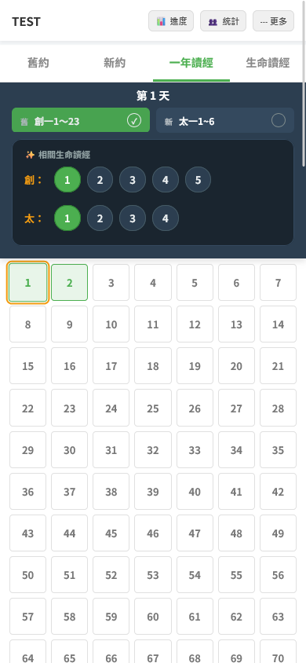

# 📖 聖經與生命讀經 進度紀錄

一個以 LINE Bot (選填) + Google Apps Script (GAS) 製作的讀經進度紀錄應用，幫助群組成員記錄每日讀經、追蹤完成度，並同步整合生命讀經進度與群組統計排名。

<p align="center">
  
</p>

## ✨ 功能特色

- **自由讀經** — 從舊約 39 卷 / 新約 27 卷中任意選取章節打卡。
- **一年讀經一遍** — 內建 364 天讀經計畫，每日包含舊約與新約自動配對進度。
- **✨ 生命讀經 (Life-Study) 整合** — 
    - **自動連動**：根據一年讀經進度，自動顯示當日對應的生命讀經篇目。
    - **專屬紀錄**：可獨立勾選生命讀經進度，並提供「生命讀經」分頁進行全本編輯。
- **智慧去重與同步** — 自由讀經、一年計畫與生命讀經紀錄自動合併，確保數據精確且不重複計算。
- **個人進度儀表板** — 即時查看舊約、新約、一年計畫及生命讀經的完成百分比。
- **📊 群組成員統計與圖表** — 
    - **進度排行**：查看群組內所有成員的閱讀比例與即時排名。
    - **視覺化圖表**：提供可自訂篩選（舊約/新約/生命讀經、Top 10/20 排行）的長條圖，支援自適應高度與階梯式 X 軸上限縮放。
    - **一鍵匯出**：生成附有白色底色的統計圖表圖片，支援手機長按複製或下載分享，便於每週回顧。
- **LINE Bot 整合 (選填)** — 在 LINE 群組輸入 `/GET URL` 即可取得專屬讀經連結。若不整合 LINE Bot，使用者亦可直接在網頁網址後方手動帶入 `?groupId=您的群組ID` 來開啟與記錄。
- **卓越用戶體驗** — 
    - **批次儲存**：優化章節選取邏輯，支援一次勾選多章後批次儲存。
    - **PIN 驗證**：4 位數字密碼搭配 SHA-256 雜湊，保護個人資料。

## 🏗️ 技術架構

| 層級 | 技術 |
|------|------|
| 前端 | 單頁 HTML + Vanilla JS + CSS（Mobile-first RWD） |
| 後端 | Google Apps Script (GAS) |
| 資料庫 | Google Sheets（Progress / Users / Stats 三張工作表） |
| 訊息整合 | LINE Messaging API（選填，用於群組互動） |
| 部署 | GAS Web App（`doGet` 渲染頁面、`doPost` 處理 Webhook） |

## 📁 專案結構

```
bible-tracker/
├── index.html      # 前端網頁主骨架（透過樣版動態引入 CSS 與 JS）
├── css.html        # 前端樣式表（CSS）
├── js.html         # 前端網頁邏輯（JS）
├── backend.gs      # GAS 後端主邏輯（API 處理、帳號安全鎖、Properties 延遲載入）
├── constants.gs    # 後端常數資料庫（聖經章節數據、生命讀經映射表）
├── README.md       # 專案說明文件
└── pic/            # 文件資源與範例截圖
```

## 🚀 部署步驟

### 1. 建立 Google 試算表與 Apps Script 專案

1. 新建一個 Google 試算表 (Google Sheets)。
2. 在試算表選單點擊「擴充功能 → Apps Script」開啟專案（此為容器綁定腳本，後端程式才能自動取得該試算表）。
3. 建立新 HTML 檔案並命名為 `css`，貼入 `css.html` 內容。
4. 建立新 HTML 檔案並命名為 `js`，貼入 `js.html` 內容。
5. 將預設的 `Code.gs` 重新命名為 `backend`，貼入 `backend.gs` 內容。
6. 建立新指令碼檔案並命名為 `constants`，貼入 `constants.gs` 內容。
7. 新增 HTML 檔案並命名為 `index`，將 `index.html` 的內容貼入。

### 2. 自動初始化試算表工作表

本系統無須手動建立工作表。當部署完成且首次執行（例如網頁登入或儲存進度）時，後端程式會自動在該試算表中建立以下工作表：

- **Progress** — 儲存所有讀經紀錄 `[UserID, GroupID, Book, Chapter, Timestamp]` 等。
- **Users** — 儲存用戶帳號 `[Username, PIN_Hash, UserID]` 等。
- **Stats** — 統計快取 `[GroupID, UserID, OT, NT, LS_OT, LS_NT]` 等。

### 3. 設定指令碼屬性 (選填，僅在使用 LINE Bot 時需要)

若不整合 LINE Bot，此步驟可完全跳過。如需使用 LINE Bot，請在 GAS「專案設定 → 指令碼屬性」中設定：

| 屬性名稱 | 說明 |
|----------|------|
| `LINE_CHANNEL_ACCESS_TOKEN` | LINE Channel Access Token |
| `WEBAPP_URL` | GAS 部署後的 Web App URL（需以 `exec` 結尾） |

### 4. 部署 Web App

1. 點擊「部署 → 新增部署作業」。
2. 類型選擇「網頁應用程式」。
3. 存取權限設為「所有人」。
4. 複製部署 URL（若有使用 LINE Bot，務必將此 URL 更新回指令碼屬性的 `WEBAPP_URL`）。

### 5. 設定 LINE Bot (選填)

若您希望在 LINE 群組中與 Bot 互動：
1. 在 [LINE Developers Console](https://developers.line.biz/) 建立 Messaging API Channel。
2. 將 GAS 部署 URL 設為 Webhook URL。
3. 將 Bot 加入 LINE 群組。
4. 在群組中輸入 `/GET URL` 即可取得該群組專屬的讀經連結。

💡 **提示 (無 LINE Bot 時的替代使用方式)**：
如果不設定 LINE Bot，您依然可以直接在 GAS 部署後的「網頁應用程式 URL」尾端手動加上參數 `?groupId=您的自訂群組名稱`（例如 `https://script.google.com/macros/s/.../exec?groupId=ourgroup`），並將此完整 URL 分享給群組成員或加入手機主畫面，即可直接使用進度登錄與群組成員統計功能。

## 📱 使用方式

1. **登入**：透過連結開啟，輸入姓名與 4 位密碼（首次進入自動註冊）。
2. **讀經**：
    - 切換「舊約/新約」進行自由打卡。
    - 切換「一年讀經」跟隨每日進度，下方會顯示相關的生命讀經篇目。
3. **管理**：點擊「📊 進度」查看概況，或至「生命讀經」分頁中進行進階編輯。
4. **清理**：若需重新開始，可在「更多」頁面中選擇清除特定範圍的紀錄。

## 📄 授權

MIT License